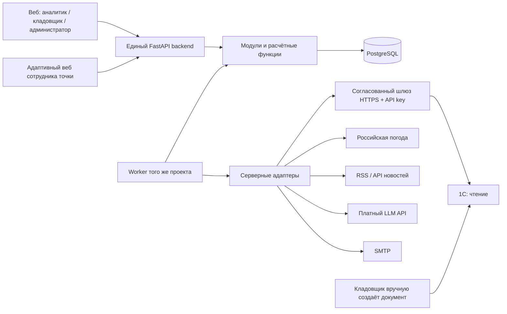
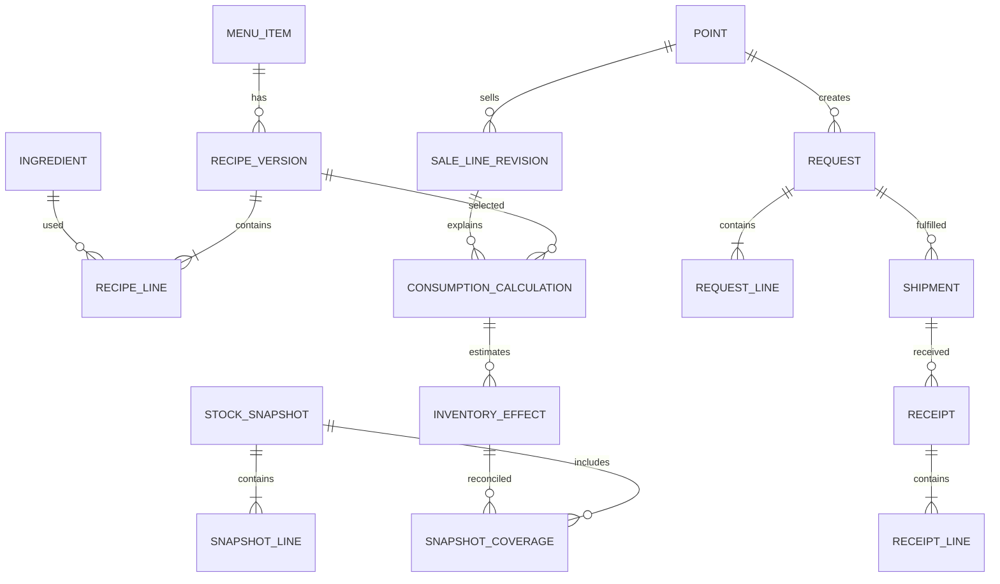

# Архитектура и модель данных

Статус: проект решения. Названия сущностей и модулей относятся к нашему приложению. Они не предполагают конкретные таблицы или API заказчика.

**После уточнений:** обязательный результат — автономный демонстрационный MVP за шесть недель. Разделы о реальном шлюзе, полной модели импорта и production-эксплуатации описывают целевое развитие. Их не нужно реализовывать целиком в первом стенде. История и тестовая 1С отсутствуют; все учебные остатки, продажи, накладные и техкарты синтетические.

## 0. Два режима учёта и развёртывание на ПК

`inventory_mode=application_ledger` — основной MVP. Начальный остаток задаётся демонстрационной инвентаризацией, далее собственный остаток приложения = начальный остаток + уникальные проведённые физические эффекты. Кладовщик создаёт внутреннюю накладную (отдельная `shipment` в заявке, номер/дата/строки/склад/точка/версия); её печатное представление не считается автоматически официальным документом 1С. При отправке уменьшается собственный складской остаток и появляется товар в пути; при приёмке увеличивается остаток точки только на принятое количество. Отмена ещё не отправленной накладной снимает резерв; после отправки исправление — отдельное документированное движение/возврат. Продажи из demo-генератора списывают ингредиенты по версии техкарты. Ручные списания по причинам и корректировки требуют роли, основания и аудита.

`inventory_mode=one_c_snapshot` — будущая интеграция и отдельный demo-тест. Подтверждённый остаток поступает из снимков, а локальные операции накладываются только по правилам coverage. В этом режиме действуют раздел 5 и контракт сверки. В интерфейсе показывается режим и источник каждой величины. Один и тот же scope не работает одновременно по двум формулам. Переход на 1С требует инвентаризации/сверки, сопоставления незакрытых документов, фиксации cutover-снимка и архива начального собственного ledger; никогда не складывать начальные остатки двух систем.

Развёртывание: один выделенный постоянно включённый ПК, на котором работают backend, worker и БД; браузеры на нём и на телефонах/планшетах используют один сервер. Интернет сам по себе не обеспечивает доступ телефона к ПК: для MVP предполагается общая локальная сеть; внешний доступ позже через согласованный VPN/TLS, без публичного открытия PostgreSQL. Проверка ОС, памяти, виртуализации/Docker и сетевых прав — задача первой недели. До доступа к ПК заказчика стенд запускается на ПК команды. Если Docker недоступен, нужен согласованный нативный запуск тех же компонентов, а не незаметный отказ от воспроизводимости.

Резервное копирование: ежедневный `pg_dump` в защищённое хранилище, отдельная копия вне диска серверного ПК; для demo предложены 7 ежедневных и 4 еженедельные копии. Это проектная политика, не подтверждённое требование заказчика. Отдельно сохранить конфигурацию без открытых секретов и инструкции восстановления. Восстановить в чистую БД и сравнить пользователей, накладные, остатки и историю. RPO/RTO измерить на стенде и согласовать для эксплуатации. Excel/Word/CSV-экспорт отчёта не заменяет dump, ограничения БД и связи объектов.

## 1. Модульный монолит



Один репозиторий, один backend-артефакт, одна БД. API и worker — два процесса того же приложения, не независимые микросервисы. Шлюз у 1С появляется только при необходимости преобразовать доступный интерфейс и обеспечить согласованный контракт; его размещение определяет ИТ заказчика. Frontend обращается только к нашему API.

Предлагаемая структура для будущей реализации:

```text
backend/app/
  identity/          пользователи, сессии, политики доступа
  catalog/           точки, номенклатура, единицы, техкарты
  integration/       inbox, курсоры, mapping, сверка, качество
  inventory/         снимки, эффекты, оперативные оценки
  analytics/         показатели и объяснимые правила внимания
  forecasting/       наборы признаков, обучение, оценка, прогноз
  replenishment/     рекомендации, заявки, поставки, приёмки
  context/           погода, новости, структурированные события
  notifications/     outbox, каналы, попытки доставки
  audit/             действия, изменения статусов, диагностика
  adapters/          one_c, weather, news, llm, email: demo/real
  worker/            периодические и разовые задания
frontend/src/        общий клиент и два режима интерфейса
migrations/ tests/ docs/ demo/ experiments/
```

В каждом модуле: доменные типы и чистые расчёты; прикладные сценарии и транзакции; репозитории/адаптеры; HTTP-схемы и маршруты. Расчёт потребности не вызывает HTTP и не зависит от React. Взаимодействие модулей — через явные функции/интерфейсы; общие таблицы не обновляются произвольно из соседних модулей.

## 2. Стек и границы сложности

| Выбор | Причина | Ограничение |
|---|---|---|
| Python + FastAPI + Pydantic | Один язык расчётов и API, явные типы входов, схема OpenAPI | Версии фиксировать lock-файлом на этапе 1; API-схемы не заменяют проверки прав |
| PostgreSQL + SQLAlchemy + psycopg + Alembic | Транзакции, ограничения уникальности, точная арифметика, контролируемые миграции | JSONB только для исходных сообщений/метаданных; ключевые бизнес-поля нормализованы |
| React + TypeScript + Vite, React Router, TanStack Query | Общие экраны, типизированный API-клиент, серверное состояние и повтор запросов | Кэш разделять по пользователю и scope, очищать при выходе; права проверяет backend |
| Worker + таблица jobs в PostgreSQL | На первом этапе не нужны брокер, Redis и отдельный оркестратор | Lease, повторная обработка и идемпотентность обязательны; нагрузку проверить |
| httpx; стандартный email/SMTP-клиент | Тайм-ауты, контролируемые HTTP-адаптеры и простой канал email | Никаких ключей во frontend; платные вызовы отдельно ограничены |
| pandas/NumPy, scikit-learn, CatBoost | Подготовка данных, метрики и разумный табличный кандидат | Не считать сложность модели доказательством качества |
| PyTorch, небольшая GRU | Исследование численного прогноза с контролируемым числом параметров | Не включать в критический путь API; CPU-эксперимент и ограниченный бюджет |
| pytest, Playwright, Ruff, проверка TypeScript | Инварианты учёта, права, контракт и сквозной сценарий | Проверять PostgreSQL, а не полагаться только на SQLite |
| Docker Compose | Воспроизводимый учебный запуск API, worker, PostgreSQL и веб | Локальный mail sink; реальные секреты и production-параметры не входят в образ |

Окончательные совместимые версии и UI-компоненты фиксируются на этапе 1 после проверки окружения команды. Это обоснованный целевой набор, пока без установки зависимостей. FastAPI документирует OpenAPI/JSON Schema [в официальном описании](https://fastapi.tiangolo.com/features/); выбор ORM остаётся свободным [по документации](https://fastapi.tiangolo.com/tutorial/sql-databases/).

Для jobs worker краткой транзакцией захватывает доступные строки через `FOR UPDATE SKIP LOCKED`, ставит `lease_until`, выполняет работу вне длительной блокировки, затем атомарно фиксирует результат. Истёкший lease разрешает повтор; обработчик обязан быть идемпотентным. PostgreSQL описывает `SKIP LOCKED` как пригодный для очередей, но не для общего согласованного чтения: [SELECT](https://www.postgresql.org/docs/current/sql-select.html). Дедупликация расписания — уникальный `(job_type, scope, scheduled_slot)`. При росте нагрузки брокер можно добавить за этим интерфейсом.

## 3. Интерфейсы и серверные права

Основной веб: «Обзор», отдельная «Аналитика», отдельный «Прогноз спроса», «Остатки», «Заявки», «Комплектация», «Качество данных», административные настройки. Мобильный режим: моя точка, предупреждения, остатки, заявка, приёмка с фактическим количеством и расхождениями. Всё на русском; статусы, единицы, сообщения об ошибках и подписи графиков также переведены.

На экране и в экспорте: источник данных, `data_as_of`, последняя успешная синхронизация relevant-потока, предупреждение о давности, статус расчёта, демонстрационный режим. Для прогноза дополнительно дата формирования, горизонт, модель, интервал и доступность внешних признаков. Для заявки — ссылки на расчёт и исходные версии остатков/прогноза.

| Роль | Чтение | Изменения |
|---|---|---|
| Администратор | Пользователи, scopes, технические статусы, аудит в назначенном контуре | Права, интеграции, лимиты, настройки; не получает право тихо редактировать учётные факты |
| Аналитик/руководитель | Показатели и прогнозы разрешённых точек | Настройки правил, запуск расчётов; изменение рецептур в аналитической копии не подменяет 1С |
| Сотрудник точки | Только назначенные точки, их остатки, предупреждения, заявки | Создание заявки, допустимая отмена, подтверждение приёмки своей точки |
| Кладовщик | Назначенные склады и обслуживаемые ими разрешённые точки, связанные заявки | Принятие, комплектация, отправка, частичные отгрузки, фиксация документа 1С |

`user_role`, `user_point_scope`, `user_warehouse_scope` и `warehouse_point_service` определяют пересечение доступа. Кладовщик не получает все точки только из-за связи одного склада. Любой запрос, включая агрегаты, export, detail по ID, job status и уведомления, проходит проверку роли и scope. Переданный `point_id` не считается доказательством доступа. Отсутствующий и чужой объект возвращают одинаковый 404; запрет действия над доступным объектом — 403. Worker выполняет делегированную задачу в зафиксированном scope и проверяет актуальные права перед выдачей результата. Системные задания используют ограниченную техническую роль.

Для начального онлайн-веба: серверные сессии с HttpOnly/Secure/SameSite cookie, защита CSRF для изменений, ограничение попыток входа, хеширование паролей подходящей библиотекой, отзыв сессий. Если заказчик требует SSO — заменить вход адаптером OIDC, политики доступа сохранить. Секретные данные и API-ключи не хранить в localStorage. Режимы интерфейса — удобство, не механизм защиты.

## 4. Логическая модель данных

Все импортируемые объекты получают внутренний UUID и mapping `(source_system, entity_type, external_id)`. Версии неизменяемы; исходные payload сохраняются с ограниченным сроком хранения и доступом. Количества и деньги — `NUMERIC`, не float; в JSON количество — десятичная строка. Время хранится в UTC вместе с timezone точки; бизнес-день вычисляется по её времени и согласованной границе смены.

| Группа / таблицы | Ключевые поля и связи |
|---|---|
| `user`, `role`, `user_role`, `user_point_scope`, `user_warehouse_scope`, `session` | Пользователь, роль, область доступа, отзыв сессии |
| `point`, `warehouse`, `warehouse_point_service`, `opening_calendar` | Координаты, timezone, расписание и исключения, доступные маршруты снабжения |
| `unit`, `ingredient`, `menu_item`, `menu_variant`, `unit_conversion_version` | Базовая единица, размерность; ingredient-specific коэффициент с периодом действия; SKU варианта |
| `recipe_version`, `recipe_line`, `recipe_modifier`, `menu_availability` | Позиция/вариант/точка, период действия, выход порций, ингредиент, gross/net, потери, добавки/замены; доступность и причина |
| `sale`, `sale_line_revision`, `sale_adjustment` | Внешние ID, revision, point, event time, received time, количество, выручка, цена/скидка, recipe_version, приготовление, связь отмены/возврата |
| `consumption_calculation`, `consumption_line` | Точная ревизия строки продажи, техкарта, пересчёты и версия алгоритма; количество расхода и объяснение |
| `stock_snapshot`, `snapshot_line`, `snapshot_coverage` | source_generation, scope, as_of, опубликованная версия снимка, партия, физический остаток, включённые эффекты и их количества |
| `inventory_effect`, `effect_revision`, `effect_source_link` | Каноническая физическая операция, место, ингредиент/партия, signed_qty, origin, статус, effective_at; связи продажи, движения и приёмки |
| `stock_movement_revision`, `inventory_reconciliation` | Приход/расход/перемещение/инвентаризация/списание, исходный документ; ожидаемое и подтверждённое количество, расхождение, решение |
| `lot`, `reservation`, `stock_quality_issue` | Партия, expiry, карантин/брак, владелец и назначение резерва; неизвестность срока годности и отрицательные остатки |
| `replenishment_policy`, `forecast_run`, `forecast_value` | Lead time, review period, service target, MOQ/pack/capacity; origin, horizon, модель, point×item×day, interval, data quality |
| `recommendation_run`, `recommendation_line` | Версии исходных данных и правил, прогноз расхода, пригодный остаток, incoming, safety stock, ограничения и объяснение |
| `request`, `request_line`, `request_transition` | Точка, склад, статус, version для конкуренции, idempotency_key, заказано/отменено/отгружено/принято/не принято |
| `shipment`, `shipment_line`, `receipt`, `receipt_line`, `supply_commitment` | Внутренняя накладная: номер, дата, автор, версия, склад/точка, строки; партии, сроки, план/факт, подтверждение, внешний документ при наличии, link к эффекту; ещё ожидаемое количество |
| `price_version`, `promotion`, `ingredient_cost_version`, `writeoff` | Периоды действия и известности; необязательные источники экономики |
| `weather_vintage`, `news_source`, `news_article_revision`, `local_event`, `event_evidence` | Получено/опубликовано/выпущено, период действия, координаты, URL, содержание/хеш, география и доказательства |
| `llm_run`, `budget_reservation`, `usage_ledger` | provider/model, prompt/schema version, hash, status, usage, стоимость известная/оценочная, лимиты |
| `dataset_manifest`, `model_artifact`, `evaluation_run`, `evaluation_metric` | Хеши, cutoffs, folds, seeds, код, параметры, метрики и provenance demo/customer |
| `sync_run`, `sync_cursor`, `inbox_event`, `integration_error`, `external_identity` | Поколение источника, поток, cursor, received/applied, retries, hash; quarantine и повтор |
| `job`, `outbox`, `notification`, `delivery_attempt`, `audit_entry` | Дедупликация, lease, канал, получатель, попытки/ошибка; actor/scope/action/trace_id |

Основные связи:

Для первого MVP достаточно users/scopes, points/warehouses, ingredients/units, demo recipes/sales, inventory_effect, requests/shipments/receipts, jobs/outbox/audit. Остальные сущности добавляются миграциями по этапам. Полный список выше — целевая модель, а не требование одновременно создать десятки таблиц на первой неделе.



Ограничения БД: unique внешнего ID в источнике; unique `(source_generation, stream, event_id, revision)`; один активный рецепт на комбинацию точки/варианта/интервала (интервалы не пересекаются); внешние ключи; уникальность причинных связей без двойного владения количеством; положительные количества строк приёмки и отгрузки; отрицательные **остатки допустимы** и создают проблему качества. Историческая техкарта не перезаписывается. Изменения задним числом создают новую ревизию и явную процедуру пересчёта с аудитом.

## 5. Расход и остатки

Расход строки: `порции / выход_рецепта_в_порциях × gross_qty_ингредиента`, затем пересчёт в базовую единицу. Если источник даёт net и потери, сначала согласуется определение потерь: например, при доле потерь от входа `gross = net / (1-loss)`. Нельзя автоматически применять один коэффициент к любому полю «потери» или повторно увеличивать уже указанное gross. Версии единиц и рецепта фиксируются в расчёте.

Вариант блюда выбирает свою техкарту; добавка добавляет компонент, замена заменяет исходный компонент, а не добавляет оба. Неизвестная замена или неоднозначная рецептура даёт неполный расчёт с предупреждением, не расход 0. Для составных полуфабрикатов до реализации определить границу учёта: списываем либо учтённый полуфабрикат, либо его сырьё; не оба одновременно.

Отмена до приготовления не потребляет сырьё. Возврат готового блюда корректирует финансовые показатели, но не восстанавливает ингредиенты. Возврат сырья, если он физически произошёл, требует отдельного подтверждённого движения. Неизвестный факт приготовления не трактуется автоматически как восстановление. Механизм исключения повторного списания, поздних движений и снимков подробно определён в [контракте](02-integration-contract.md).

В режиме 1С отображаем три разные величины: подтверждённый остаток 1С; оперативную оценку с перечнем ещё не подтверждённых эффектов (если сверка обеспечена); пригодный доступный запас для рекомендаций. В самостоятельном режиме — «остаток приложения» и «пригодно по данным приложения»; поле подтверждения 1С показывает «не подключено». Просрочка, карантин и резервы не изменяют физический остаток, но ограничивают доступность. Отрицательный остаток не обрезается до нуля в учёте и не маскируется в UI.

## 6. Корзина пополнения

Окно покрытия: от расчёта до ближайшей возможной поставки плюс интервал до следующего заказа, с календарём отгрузок. Потребление до прибытия отдельно показывает неустранимый этой поставкой риск дефицита. Расход суммируется по **всем** блюдам, вариантам и добавкам с известной структурой; будущие техкарты применяются только если их ввод уже известен на момент расчёта. При неизвестной структуре добавок нужна явная оценка распределения, а не фиктивная точность.

`Q_raw = max(0, D_window + SS - A_usable - I_confirmed)`.

- `D_window`: прогноз сырьевого расхода за окно.
- `SS`: настроенный или оценённый по историческим ошибкам запас; цель сервиса согласует заказчик. Нельзя суммировать дневные верхние границы как будто это совместный квантиль; лучше калибровать ошибку суммарного расхода за окно.
- `A_usable`: пригодный остаток, доступный для этого спроса. Резервы под тот же спрос **не вычитаются**, иначе потребность будет посчитана дважды. Резерв под внешний спрос либо исключается из `A_usable`, либо его обязательство включается в `D_window`, но не оба. Неидентифицированный резерв блокирует автоматическое утверждение корзины.
- `I_confirmed`: только ещё не принятые подтверждённые количества, которые прибудут вовремя и будут пригодны. Черновик заявки — не поставка. Принятые единицы исключаются из incoming в той же транзакции, в которой создаётся оперативный эффект приёмки.

Базовая формула даёт ориентир. Итоговый расчёт проходит дневную симуляцию: FEFO, срок годности каждой партии, дата прибытия, доступный складской остаток без чужих резервов, общий объём хранения точки, упаковки и MOQ. Просроченное до использования количество исключается; неизвестный expiry явно снижает доверие и запрещает утверждать отсутствие риска порчи. Срок, остаток или вместимость не угадываются.

После округления вверх до упаковки и MOQ снова проверяются ограничения порчи и вместимости. Если подходящего объёма нет, выдаётся 0 или допустимая неполная корзина с явным дефицитом и предложением ручного решения, а не заведомо избыточный заказ. Общая вместимость проверяется по всей корзине, а складские ограничения — с атомарным резервированием при принятии нескольких заявок. При недостатке склада применяется согласованный приоритет; пока он не утверждён, решение кладовщика. Для редких позиций сравнивать SS=0 и малые упаковки; фиксированный процент от спроса не включать без проверки избытка.

Строка корзины: ингредиент, единица, подтверждённый и пригодный остаток, ожидаемый расход, SS, incoming, raw/итоговое количество, срок потребности, ограничения и числовое объяснение. Пример **синтетический**: расход 1000 г, SS 200 г, пригодно 400 г, подтверждённое поступление 300 г → 500 г до упаковок. Если текущий прогноз/остаток устарел сверх настройки, корзина помечается для ручной проверки и не утверждается автоматически.

## 7. Жизненный цикл заявки и уведомлений

Основная цепочка: `новая → принята → комплектуется → отправлена → получена`. Отмена — отдельный терминальный статус при отсутствии исполненной части. Переходы проверяет backend, каждый содержит actor, время, комментарий и optimistic version. Повтор с тем же idempotency key возвращает прежний результат; другой payload с тем же ключом — 409.

Частичные поставки отражаются строками и отдельными shipment/receipt. При частичной отправке заявка может оставаться «комплектуется» с отметкой «частично отправлена»; после завершения отправок — «отправлена». Частичная приёмка оставляет её открытой с отметкой «частично получена». «Получена» ставится, когда все неотменённые количества получены либо остаточные расхождения явно закрыты с причиной. Исполненную часть нельзя отменить или стереть: отменяется только остаток. Карантин, отказ от повреждённого товара, недостача и неожиданный излишек фиксируются отдельно; излишек требует разрешённого решения, не молчаливого превышения отгрузки.

Создание и принятие заявки не увеличивают запас точки. Отправка отражает факт отгрузки по внутренней накладной, но не поступление на точку. Приёмка добавляет только фактически принятое количество; повреждённое физически принятое — в карантин, не в пригодный запас. В самостоятельном режиме это движение собственного ledger; в режиме 1С — оперативный эффект, а подтверждённый остаток меняет только импорт. Номер/внешний ID документа 1С при наличии вводится вручную и затем проверяется импортом. Для автономного MVP номер 1С не обязателен; внутренняя накладная имеет свой номер. Автоматическая запись документа в 1С отсутствует.

Для автоматических рекомендаций unique active `(point, warehouse, planning_window, policy)`; новый пересчёт обновляет предложение, а не порождает новую заявку. Принятые заявки не меняются молча. Важное изменение создаёт новую ревизию предложения и уведомление по настройке. Дедупликация предупреждений — `(scope, ingredient, rule, episode)`: сообщение при возникновении, значимом изменении, эскалации или закрытии; не на каждом запуске.

Outbox создаётся в одной транзакции с изменением заявки. Каналы MVP: внутренняя лента и email; интерфейс канала допускает Telegram позже. Для каждой доставки записывать попытку, provider_id, статус и безопасную ошибку; ограниченные повторы с задержкой, затем очередь ошибок и ручной повтор. Сбой SMTP после отправки до подтверждения может дать повторное письмо: не обещаем exactly-once внешней доставки, используем стабильный Message-ID и idempotency провайдера, если доступна. Локальный demo-перехватчик не отправляет письма реальным адресатам.

## 8. Эксплуатация и безопасность

Конфигурация через окружение: режим данных, DSN, адреса адаптеров, интервалы, лимиты, уровни логов. `.env.example` содержит только названия и безопасные заглушки; `.env`/секреты исключаются из Git. Секреты production — серверное защищённое хранилище или ограниченно доступные runtime-файлы; исходящие ключи нельзя просто хешировать, поскольку их нужно предъявлять провайдеру. Входящие ключи шлюза проверяются по защищённому хешу; полный ключ показывается только при выпуске. TLS, проверка сертификата, отзыв, ротация, scopes и ограничение источников описаны в контракте.

Аудит append-only для прикладной роли: входы, доступы, изменение правил, статусов, приёмки, ручная сверка, запуск модели. Логи структурированные, с trace_id, без Authorization/API keys и без полного текста чувствительных payload. Ошибка API: стабильный code, русское сообщение, trace_id, безопасные field_errors; не stack trace. Наблюдаемость: задержка импорта по потоку, ошибки/карантин, расхождения, свежесть прогнозов, очередь задач, доставки, расходы LLM.

Миграции Alembic в CI проверяются на пустой и предыдущей БД; потенциально разрушающие изменения — отдельный план сохранения данных. Резервная копия до миграции, регулярные копии и проверка восстановления; RPO/RTO и retention согласовать до пилота. Публичные health/readiness endpoints не раскрывают секреты; frontend работает через один origin/reverse proxy. Тяжёлое обучение запускается worker-заданием с ограничением ресурсов и не блокирует учётные транзакции.
